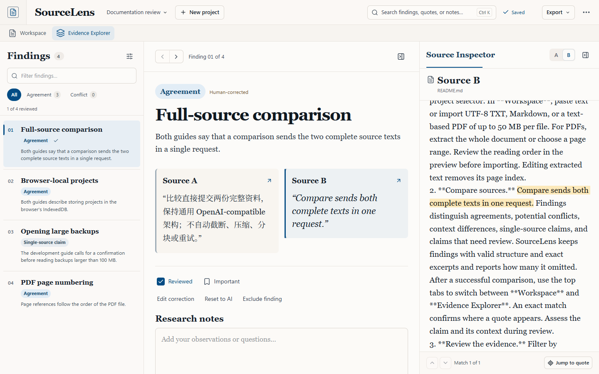

# SourceLens

SourceLens is a local research workspace for comparing claims across two documents and tracing each finding back to its exact source text. The stable version is [V0.9](https://github.com/sx933229xiao-droid/sourcelens-evidence/tree/v0.9).



*The V0.8.1 screenshot shows a sample review of the project's Chinese and English documentation.*

## Run locally

Use Node.js 22.13 or later in the Node.js 22 release line and npm. For a first-time setup in PowerShell:

```powershell
git clone https://github.com/sx933229xiao-droid/sourcelens-evidence.git
Set-Location sourcelens-evidence
npm ci
Copy-Item .env.example .env.local
```

Set your OpenAI-compatible provider in `.env.local`:

```dotenv
LLM_BASE_URL=https://your-provider.example/v1
LLM_MODEL=your-model-name
LLM_API_KEY=your-api-key
```

Include the provider's API version prefix in `LLM_BASE_URL`. SourceLens appends `/chat/completions`. The provider must accept `model` and `messages` and return text in `choices[0].message.content`. Keep the key in the server-side environment.

Run `npm run dev` and open **http://127.0.0.1:3000** or the address printed by Next.js. To try a comparison, use **Try Example** to load two fictional texts, then click **Compare Sources**. Restart the server after changing the provider configuration.

For a local production server, run:

```powershell
npm run build
npm start
```

## Use the workspace

1. **Prepare two sources.** Select an existing project or click **New project** beside the project selector. In **Workspace**, paste text or import UTF-8 TXT, Markdown, or a text-based PDF of up to 50 MB per file. For PDFs, extract the whole document or choose a page range. Review the reading order in the preview before importing. Editing extracted text removes its page index.
2. **Compare sources.** Compare sends both complete texts in one request. Findings distinguish agreements, potential conflicts, context differences, single-source claims, and claims that need review. SourceLens keeps findings with valid structure and exact excerpts and reports how many it omitted. After a successful comparison, use the top tabs to switch between **Workspace** and **Evidence Explorer**. An exact match confirms where a quote appears. Assess the claim and its context during review.
3. **Review the evidence.** Filter by keyword, relationship, or review status. Mark findings as reviewed or important and add research notes. Click an excerpt to highlight it in the full text in **Source Inspector**. With a PDF page index, browse physical pages, select repeated matches, or jump to a quote that spans pages. Drag the desktop dividers to resize the three panes. Source Inspector opens as a drawer on smaller screens.
4. **Correct a finding.** In the finding detail, use **Edit correction** to revise its relationship or explanation. **Reset to AI** restores the original values. **Exclude finding** hides the finding from the default list and Markdown report. To bring it back, choose **Excluded** under **Review status** in the Findings filters, then select **Restore finding** in the detail.
5. **Save or share the work.** Projects and review data save in your browser. **Export → Export Markdown** reports included findings with their current relationships, explanations, evidence, available page references, and notes. It counts excluded findings separately. **Export → Export backup** saves both sources, the original AI result, and all review data in a `.sourcelens.json` file. Use **Project actions → Restore project** to restore a valid backup as a separate project.

A failed or cancelled comparison preserves the previous analysis and its review data. Editing or replacing a source clears its analysis. SourceLens asks for confirmation before a source change or a new comparison can discard review data, including corrections and exclusions.

## Architecture and data

- **Interface.** Next.js App Router, React, TypeScript, and Tailwind CSS. Motion handles interface transitions, and react-resizable-panels controls the desktop layout.
- **Comparison.** The server sends one non-streaming request to an OpenAI-compatible Chat Completions endpoint. Zod and exact text matching validate each finding independently. The server timeout is 240 seconds, and the browser fallback is 255 seconds.
- **PDFs.** The browser extracts text using PDF.js. The dev and build scripts prepare the matching worker and font resources from the installed package. Page references use character offsets in the extracted text.
- **Local storage.** IndexedDB holds sources, the latest successful analysis, and its review. Projects belong to the browser profile and site address, including the port. The app reads imports and backups locally. Compare sends source text to the configured provider. Markdown is for reporting, and JSON is for restoring a complete project.

## Limits

- Each project compares two sources and keeps one successful analysis. Provider context and output limits apply. SourceLens sends the full input without automatic truncation or chunking.
- Scanned PDFs need OCR before import. Password-protected PDFs are unsupported. Tables, footnotes, and multiple columns can affect extraction order. Page references require a valid index and refer to page order in the file.
- Clearing browser data can remove saved projects. The app has no cloud sync, and project backups contain extracted text and metadata rather than the original PDF files.
- AI can miss or misclassify claims. Check the original evidence before relying on a finding.

For development and continuation notes, see [AGENTS.md](AGENTS.md).
