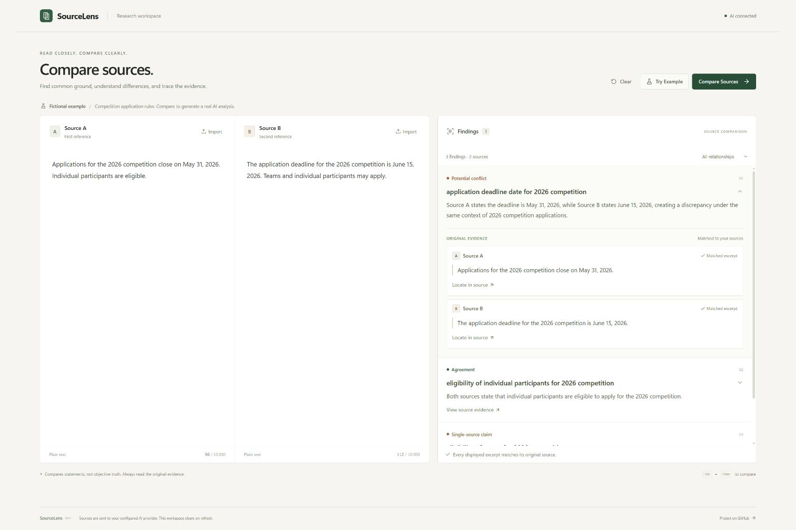

# SourceLens

**AI-Powered Source Comparison & Evidence Tracing**

SourceLens is an independently developed AI workspace for comparing claims across two sources and tracing findings back to their original evidence. It is built for students, researchers, and creators who need to check what different sources actually say.

Create a local research project, paste text or import TXT / Markdown files, run an AI comparison, and open a finding to inspect its original quotations. Return to saved projects without repeating the analysis, then export the findings and evidence as Markdown. SourceLens organizes agreements, potential conflicts, context differences, single-source claims, and statements that need review.

## Demo



*A real screenshot of SourceLens V0.2 running locally. The source texts are fictional examples; the findings were generated by a live NVIDIA model call. The expanded Potential Conflict finding shows the different application deadlines alongside verbatim excerpts from both sources.*

AI is used to compare the meaning of differently worded claims and explain differences in their context. Application code checks that every displayed quotation exists in its corresponding source. NVIDIA currently provides hosted model inference; Google Cloud Run is being evaluated to host the web application and its server-side AI endpoint. Cloud deployment has not yet been completed.

## Project Goals

- Compare information from two source documents.
- Identify agreements and potential conflicts.
- Provide AI-assisted explanations.
- Trace findings back to supporting passages.
- Present the results in a clear, interactive interface.

## Development Status

**V0.3 running locally — local research projects, autosave, analysis reuse, and Markdown export.**

The Next.js application runs locally and its production build passes. On November 10, 2026, a real NVIDIA-hosted model call completed through **Try Example → Compare Sources → Findings → Original Evidence**, and a Markdown report was downloaded. The local provider configuration uses `https://integrate.api.nvidia.com/v1` with `nvidia/nemotron-3.5-lightning-30b-a3b`; the API key is kept only in the Git-ignored local environment file. V0.3 retains the existing model, inference parameters, prompt, and evidence-validation rules. The demo image above records the earlier V0.2 comparison interface.

### Implemented

- Create, rename, switch, and delete local research projects from a compact toolbar. Each project contains two sources and its latest successful analysis.
- Native IndexedDB storage with 500ms text autosave, immediate saves for imports and analysis, and submission of pending changes before switching projects. The interface distinguishes saving, saved, and failed writes.
- Restore source text, file names, Edited markers, Findings, omitted-finding counts, and analysis time without calling AI again.
- Markdown reports containing all findings, relationship counts, source names, and verbatim evidence, independent of the on-screen relationship filter.
- Two editable plain-text sources, up to 10,000 characters each, with paste and local UTF-8 `.txt` / `.md` import.
- An **Import** button in each source panel, the imported file name, and an **Edited** marker after changing imported text. Reimporting the same file restores its original content; Clear and Try Example reset file labels.
- A fictional **Try Example** that fills the inputs; it does not supply precomputed results.
- One server-side request to an OpenAI-compatible Chat Completions API per comparison.
- Five relationships: Agreement, Potential Conflict, Context Difference, Single-Source Claim, and Needs Review.
- Findings with a topic, explanation, and expandable original excerpts; **Locate in source** selects the matching text in the input.
- Independent validation of findings. Invalid findings are omitted while valid findings remain visible; unreadable responses or responses with no usable findings return an error.
- Desktop and narrow-screen layouts, loading feedback, input limits, and errors that preserve the source text.
- After analysis, the desktop workspace gives sources and findings approximately 55:45 of the available width. Result explanations and excerpts use 14px text, with clearer 12px evidence actions.

### Verified for this delivery

- V0.3: project creation and renaming, loading the example into an empty named project without an overwrite confirmation, and a real NVIDIA comparison returning three findings in about 39.9 seconds.
- V0.3: original-evidence location and a downloaded Markdown report containing all three findings while the interface displayed only Potential conflict.
- V0.3: targeted checks preserving cached Findings, a nonzero `omittedFindings` value, analysis time, file metadata, and oversized drafts exactly; report checks for all five relationship counts and literal Markdown evidence. No test framework was added.
- V0.3 browser follow-up on November 10: reopened the saved real-model project and refreshed it, retaining all three Findings. The Markdown report exported after restoration was byte-for-byte identical to the original, including `omittedFindings` and analysis time. The server comparison count stayed at one; no new AI call was made during this pass.
- V0.3: edited both sources and immediately switched projects, then switched back and refreshed. The latest draft text survived, the active project was restored, and the real-model project retained its separate sources and results.
- V0.3 in the in-app browser: imported Chinese UTF-8 TXT with Windows line endings and a Markdown file; verified normalized text, file names, Edited markers, refresh recovery, and project switching. Reimporting the same file restored its text and cleared Edited. An explicitly created empty project also survived refresh.
- V0.3 layout checks: the restored desktop results retained the 55:45 split; narrow-screen controls had no horizontal overflow at the measured CSS viewport widths of 323px and 395px.
- Remaining browser coverage: confirmed project deletion, deletion with a pending save, and confirmed Clear / Try Example overwrites are not yet verified. Native confirmation-dialog automation timed out in both the Edge extension and the in-app browser. Clear did show a confirmation and the original draft remained intact afterward; this does not establish the confirmed overwrite paths. The follow-up found no application regression in the completed scenarios and made no runtime-code changes.
- Production build, including TypeScript checking.
- Browser operation of source inputs, example loading, and missing-configuration feedback.
- An inline check that valid findings survive alongside invalid citations, with no separate test framework or test directory.
- A real-model browser comparison of the fictional competition example: the deadline was marked as a potential conflict, individual eligibility as an agreement, and team eligibility as a single-source claim from Source B.
- Expansion of original excerpts and **Locate in source**, including selection of the exact individual-eligibility sentence in Source A.
- A V0.1 live comparison retained the three expected findings. Desktop findings width increased from 35% before analysis to 45% afterward; the narrow-screen result view remained a single column without horizontal overflow.
- V0.2 browser operation: imported a TXT with Chinese text and Windows line endings into Source A, imported Markdown into Source B, edited imported text, and reimported the same file. The comparison button remained available with valid sources, and the narrow-screen import controls did not cause horizontal overflow.

This verifies the complete AI-to-evidence workflow for this example; it does not establish accuracy across arbitrary documents or every relationship category. No precomputed comparison results are used.

### V0.1 response timing

One real example comparison with the existing NVIDIA Lightning model took **44,272ms**: **44,157ms** until provider response headers, **115ms** receiving the response body, and **1ms** parsing and verifying findings. The provider reported 3,733 completion tokens, including 3,374 reasoning tokens (about 90%). One timing line is written to the server console per successful comparison; it contains durations and token counts, without source text or credentials.

For this non-streaming request, the wait before headers can include connection setup, provider queueing, and generation; these timings cannot isolate pure inference from network or queue time. The observed delay is in the external provider call rather than local parsing or evidence validation. V0.1 retains the existing model parameters. The smallest proposed next adjustment is lowering NVIDIA's supported `reasoning_budget` from its documented default of 16,384 to 1,024, then checking the same findings and excerpts. The five relationship types and citation validation remain in place. See [NVIDIA's model API reference](https://docs.api.nvidia.com/nim/reference/nvidia-nemotron-3-5-lightning-30b-a3b-infer).

## Run Locally

Use Node.js 22 and npm. In PowerShell:

```powershell
git clone https://github.com/sx933229xiao-droid/sourcelens-evidence.git
Set-Location sourcelens-evidence
npm ci
Copy-Item .env.example .env.local
```

Edit `.env.local` with your provider's configuration:

```dotenv
LLM_BASE_URL=https://your-provider.example/v1
LLM_MODEL=your-model-name
LLM_API_KEY=your-api-key
```

`LLM_BASE_URL` must include the provider's API version prefix, without `/chat/completions`; SourceLens appends that path. The provider must accept `model` and `messages` and return text in `choices[0].message.content`. SourceLens requests JSON in the prompt and validates the response itself; it does not require a provider-specific structured-output feature.

```powershell
npm run dev
```

Open **http://127.0.0.1:3000** (or the port printed by Next.js). Click **Try Example**, then **Compare Sources**. A configured status means the environment variables are present; only a successful comparison confirms a working provider connection. Restart the server after changing AI configuration.

To use a local source, click **Import** in Source A or Source B and choose a UTF-8 `.txt` or `.md` file. Its text fills the existing editor and its name appears in the panel header. Markdown remains plain text, ready to compare. You can continue editing; the file on disk is not changed. Windows line endings are normalized to the editor's line endings so excerpt location continues to use the displayed text. Empty or oversized files show a panel message without replacing the current source.

For a production build and local production server:

```powershell
npm run build
npm start
```

`npm run build` performs the production compilation and TypeScript check. The application is bound to the local machine by default. Public hosting has not been set up.

## How Evidence Is Handled

SourceLens compares statements rather than deciding objective truth. Different dates may indicate a potential conflict, an update, or different conditions. A missing statement is not treated as disagreement.

Every displayed quote must be an exact substring of its corresponding submitted source. Agreement, Potential Conflict, and Context Difference require evidence from both sources. An invalid quote or invalid structure removes that finding, and the interface reports the number omitted. Matching an excerpt verifies its presence in the input, **not** the truth of the claim or the correctness of the AI explanation.

Analysis is tied to the submitted text: inputs and project operations are locked during a request, and editing either source clears its previous analysis. Reopening a saved project does not repeat the AI call or change its findings, omitted count, or analysis time. When unchanged sources are explicitly compared again, a failed request preserves the last successful result. A comparison times out after 60 seconds and can be retried manually.

## Local Research Projects and Reports

Use **New Project** to start a separate comparison, **Rename** to name it, and the project selector to return to an earlier one. **Delete project** removes its local record after confirmation. An untouched initial blank workspace is not stored; explicitly created or named projects are retained even when empty.

Text edits save after a 500ms pause. Imports, successful analyses, renaming, and confirmed Clear / Try Example actions save immediately. Switching projects submits pending edits first. Wait for **Saved locally** before refreshing or closing; unsaved changes trigger a leave-page warning, and a failed save keeps the current data visible with a **Retry** action.

**Clear** keeps the project but removes its sources and analysis. **Try Example** replaces them with the fictional example. These actions ask for confirmation only when source content or an analysis would be overwritten. Editing a source invalidates the existing analysis; older source versions and analysis history are not retained.

**Export Markdown** downloads the full current analysis, including project and source names, the original analysis time, all five relationship counts, Findings, corresponding original evidence, and the omitted-finding count. It exports all findings regardless of the selected relationship filter. Full source documents are not appended, and exporting never calls AI.

## Data and Credentials

Projects are stored in this browser's IndexedDB, without a cloud database or accounts. Only current editor text, file names and Edited markers, the latest analysis, and necessary project metadata are retained. Original files, old versions, raw provider responses, and generated reports are not stored. Imported files are read in the browser, without uploading the file to the app server. Only clicking **Compare Sources** sends the current source text to your configured AI provider; the provider's own data policies apply. Application code does not log complete source text.

Local projects belong to the browser profile and exact site origin, including the port: `localhost` and `127.0.0.1` are separate storage locations. Clearing site data, private browsing, or browser storage eviction can remove saved projects. Use a consistent address and export useful reports. V0.3 is intended for editing in one tab and does not merge concurrent changes from multiple tabs or sync across devices. Projects have no arbitrary count limit or automatic expiration; delete unwanted projects to release their records.

API credentials are used only on the server. `.env.local` and other real environment files are ignored by Git; `.env.example` contains placeholders only. Never add credentials with a `NEXT_PUBLIC_` prefix or commit a real API key.

## Current Limits

V0.3 compares two texts per project, pasted or imported from UTF-8 TXT / Markdown files, with up to 10,000 characters each. In-progress editor drafts may be saved above the comparison limit, but must be shortened before comparing. URL fetching, PDF / Word import, analysis history, project backup/import, and external fact checking are not implemented. Markdown reports are readable exports, not restorable project backups. AI can miss claims or misclassify relationships, and exact-quote validation can omit otherwise useful findings if the model alters their quotations. Review the original sources before relying on a conclusion.

## Implementation

- Next.js App Router, React, TypeScript, Tailwind CSS, and custom CSS.
- React component state for the workspace; Zod for input and per-finding validation.
- Native IndexedDB for local projects; no database or state-management dependency.
- `src/lib/project-store.ts`: project records and local storage operations.
- `src/lib/markdown-report.ts`: Markdown report generation.
- `src/app/api/compare/route.ts`: comparison endpoint.
- `src/lib/llm.ts`: server-only provider call and prompt.
- `src/lib/comparison-schema.ts`: types, validation, and exact-quote checks.
- `src/components/`: workspace, source inputs, and evidence browsing.

## Planned Cloud Infrastructure

Google Cloud Run is being evaluated as a hosting option for the web application and its server-side AI integration endpoints.

Hosting the Next.js application would let people access the workspace in a browser without running Node.js locally, while keeping provider credentials and AI requests on the server. Model inference is currently supplied through NVIDIA's hosted API; no model is hosted on Google Cloud at this stage.

Cloud deployment has not yet been completed.

## Hackathon Participation

This project is being developed for the [Global AI Builder's Challenge 2026](https://global-ai-builders-challenge.devpost.com/).

Pre-hackathon work and improvements made during the official competition period will be identified separately in the final submission.

The V0 implementation is pre-hackathon work completed on November 6, 2026, starting from README-only commit `3007754`. The first real-model integration check and claim-splitting prompt adjustment followed on November 7. At the beginning of the official development period, record the then-current commit and describe subsequent event contributions separately.

## Development

Maintained by an independent developer.

Develop from a local clone using the setup instructions above. Keep credentials, generated dependencies, build output, logs, and temporary files out of version control.

For AI-assisted continuation, start with [AGENTS.md](AGENTS.md). When resuming an existing checkout, reuse its dependencies and `.env.local`; the clone and environment-copy steps above are for first-time setup.
